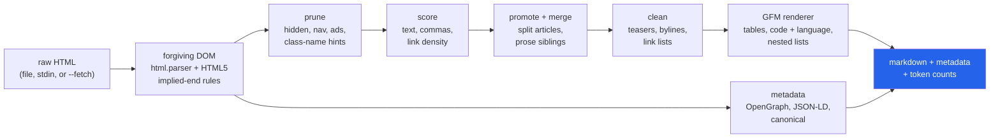

# web-to-markdown

[](https://github.com/hammasbuilds/web-to-markdown/actions/workflows/ci.yml)

We built web2md, a library and CLI that turns a web page into the markdown an LLM agent should read:
the article, not the page. It has no runtime dependencies (the DOM is built on `html.parser`), works
offline on a file or stdin, fetches over `urllib` only when asked, and returns metadata and token
counts with the markdown. We measured it against seven other systems on 3,975 hand-labelled pages from
two public benchmarks, including whether tables, code blocks and lists survive as structure. It is for
developers feeding web pages to agents or RAG pipelines.

A full web UI that uses this to import a web address lives in
[StudyLoop](https://github.com/hammasbuilds/studyloop) (Library page).

## What it does

- **Forgiving DOM:** `html.parser` plus HTML5 implied-end rules, foster parenting of stray table
  content, only the first document-level `<body>` counted, a depth cap.
- **Extraction:** prune hidden, nav and ad blocks and class-name hints; score blocks by text, commas
  and link density; promote split articles to their common ancestor and merge prose siblings; clean
  teasers, bylines and link lists; fall back without hints when the result is implausibly short.
- **GFM renderer:** headings, nested lists, tables, fenced code with the language from the
  highlighter's class, blockquotes, images; `<br><br>` prose becomes paragraphs.
- **Metadata:** title, author, date, canonical URL, description, site name and language from meta
  tags, OpenGraph, JSON-LD and markup.
- **Token estimate** without a tokenizer (within a median 2.6% of cl100k on its markdown).
- **CLI:** markdown to stdout, `--front-matter`, `--json`, `--all` (no extraction), `--fetch`.



## Sample input / output

`python demo.py` converts the four hand-written pages in [examples/](examples/), whose correct output is
known exactly, and checks every required passage is kept and every boilerplate passage removed:

```
== news_article.html
   title   : Harbour bridge reopens after two-year repair
   author  : Priya Raman   date: 2024-03-18T07:30:00Z
   tokens  : 1,126 html -> 218 markdown (81% fewer, estimated)
   kept    : 7/7 required passages
   leaked  : 0/7 boilerplate passages
== docs_page.html
   tokens  : 998 html -> 256 markdown (74% fewer, estimated)
   kept    : 4/4 required passages
   leaked  : 0/4 boilerplate passages
== blogger_post.html
   author  : Gwen Hughes   date: 2023-10-29T09:12:00+00:00
   kept    : 3/3 required passages
   leaked  : 0/5 boilerplate passages
== recipe_page.html
   kept    : 3/3 required passages
   leaked  : 0/5 boilerplate passages
all checks passed
```

Part of the markdown for the news page (cookie banner, nav, ad slot, related links, share bar and
comments are gone):

```markdown
"We replaced every one of the 1,248 suspension hangers," said chief engineer Tomasz Nowak. "The bridge is now rated for another sixty years."

## What changed

- New stainless-steel hangers throughout
- A dedicated cycle lane on the northern side
- Sensors that report cable strain every ten seconds

| Year | Daily crossings |
|---|---|
| 2021 | 40,200 |
| 2022 | 0 |
| 2023 | 0 |

> It feels like getting half the town back.
```

From the Sphinx docs page, whose `<pre>` is full of highlighting `<span>`s:

````markdown
```python
from fetchkit import Client, Retry

client = Client(retry=Retry(total=5, backoff=0.5))
response = client.get("https://api.example/items")
```
````

## Results

Printed by `python -m bench.summary` from [results/](results/). F1 is the shingle F1 of
[scrapinghub/article-extraction-benchmark](https://github.com/scrapinghub/article-extraction-benchmark)
(AEB); our port of the metric reproduces AEB's published scores to three decimals (trafilatura 0.9575,
readability 0.9223, html-text 0.6649 against 0.958, 0.922, 0.665). AEB is split by site into dev (used
for tuning) and held-out; WCEB was never used for tuning. Brackets are 95% bootstrap intervals.

| system | AEB dev (80) | AEB held-out (101) | WCEB, 7 datasets (3,794) |
|---|---|---|---|
| **web2md** | 0.972 [0.963, 0.980] | **0.973** [0.965, 0.981] | 0.883 [0.877, 0.889] |
| trafilatura | 0.952 [0.935, 0.968] | 0.966 [0.954, 0.977] | 0.873 [0.868, 0.879] |
| trafilatura-md | 0.946 [0.929, 0.962] | 0.955 [0.941, 0.968] | 0.866 [0.861, 0.872] |
| readability-lxml | 0.948 [0.919, 0.969] | 0.956 [0.944, 0.967] | **0.885** [0.879, 0.891] |
| largest-block | 0.909 [0.881, 0.935] | 0.887 [0.840, 0.929] | 0.813 [0.804, 0.823] |
| all-text | 0.682 [0.639, 0.724] | 0.660 [0.619, 0.701] | 0.741 [0.734, 0.747] |
| html2text | 0.670 [0.627, 0.714] | 0.647 [0.607, 0.686] | 0.709 [0.702, 0.716] |
| markdownify | 0.673 [0.629, 0.716] | 0.653 [0.611, 0.693] | 0.720 [0.714, 0.727] |

- **Level with the best on F1:** on AEB held-out, web2md minus trafilatura is +0.007 [-0.002, +0.017]
  (not significant), and it beats readability-lxml by +0.018 [+0.010, +0.026]. On WCEB it is level with
  readability-lxml (-0.002, not significant) and above trafilatura. No system wins every WCEB dataset;
  trafilatura leads on Google-Trends pages (0.851 vs 0.799).
- **Structure, which F1 does not score:** trafilatura's markdown keeps the text of 99% of gold code
  blocks but emits only 45% as code; web2md emits 86%, readability-lxml (rendered by web2md) 98%. Of
  gold tables, extractors deliver 35-43% as tables.
- **Tokens:** raw HTML costs a median 15,973 cl100k tokens per page. web2md's output is 94.4% smaller
  (1.06 tokens per article token); whole-page converters (html2text, markdownify) save only 64-65%.
- **Dragnet's comments:** on 420 Dragnet pages the ground truth includes reader comments. Against the
  article alone, extractors go from 0.63-0.67 to 0.89-0.92 and whole-page dumps fall from 0.74-0.77 to
  0.43-0.45, so pooled leaderboards partly measure whether a tool keeps comments.
- **Speed** (one pinned core, 320 pages, 5 repeats): median 192 ms per page against trafilatura's 131,
  readability-lxml's 115 and markdownify's 226.

<details>
<summary>Structure kept / text kept, per construct</summary>

| system | table (n=639) | code (n=231) | list (n=2006) | heading (n=9059) |
|---|---|---|---|---|
| web2md | 43% / 53% | 86% / 88% | 30% / 50% | 30% / 47% |
| trafilatura-md | 40% / 57% | 45% / 99% | 29% / 52% | 33% / 56% |
| readability-lxml | 35% / 41% | 98% / 99% | 32% / 54% | 30% / 48% |
| largest-block | 44% / 85% | 81% / 83% | 46% / 75% | 30% / 49% |
| all-text | 57% / 100% | 98% / 100% | 59% / 99% | 77% / 100% |
| html2text | 39% / 85% | 97% / 100% | 56% / 80% | 74% / 97% |
| markdownify | 59% / 91% | 98% / 100% | 52% / 96% | 78% / 99% |

A gold structure is a table, `<pre>`, list or heading whose text is in the ground-truth article.
Neither benchmark labels structure, so these are derived labels; gold code occurs on only 32 pages.

</details>

<details>
<summary>Ablations: which stage earns its keep</summary>

| variant | AEB dev | AEB held-out | WCEB (all) |
|---|---|---|---|
| web2md | 0.972 | 0.973 | 0.883 |
| no class hints | 0.954 | 0.918 | 0.883 |
| no link density | 0.963 | 0.973 | 0.879 |
| no sibling merge | 0.962 | 0.974 | 0.881 |
| no clean stage | 0.949 | 0.952 | 0.888 |
| no fallback | 0.954 | 0.899 | 0.853 |

</details>

127 tests (tree-builder recovery rules, every markdown construct, extraction fixtures, metadata,
charset decoding, a mocked fetch, the CLI and the benchmark harness), no network or data download.

## Tech stack

- Python 3.11+, standard library only at runtime (`html.parser`, `re`, `urllib`)
- Benchmark baselines (optional `baselines` group): trafilatura, readability-lxml, html2text,
  markdownify, tiktoken
- Dev: pytest, ruff, uv

## Run it

```bash
git clone https://github.com/hammasbuilds/web-to-markdown
cd web-to-markdown
pip install -e . pytest        # or: uv sync
python demo.py --show
python -m pytest -q

web2md examples/news_article.html                    # markdown to stdout
web2md examples/news_article.html --front-matter     # plus YAML metadata
web2md page.html --json --url https://site/page      # markdown, metadata, token counts
curl -s https://example.com | web2md - --url https://example.com
web2md https://example.com --fetch                   # network only when asked
web2md page.html --all                               # whole page, no extraction
```

```python
from web2md import convert

result = convert(html, url="https://example.com/post")
result.markdown         # the article as GFM
result.metadata.title   # also author, date, canonical_url, description, site_name, language
result.tokens_html, result.tokens_markdown, result.token_saving
```

web2md does not run JavaScript, so a page that builds its article client-side comes out as a shell.
It converts one page at a time; `--fetch` follows redirects but is not a crawler (no robots.txt or rate
limiting). Comment threads are removed on purpose.

Reproducing the benchmark (about 57 MB of data, roughly an hour on four cores):

```bash
uv sync --group baselines
bash bench/fetch_data.sh
uv run python -m bench.run       # writes results/*.json
uv run python -m bench.summary   # prints the tables above; refuses results made by other code
```

## Licence

MIT, see [LICENSE](LICENSE). Benchmark data, downloaded by `bench/fetch_data.sh` and not shipped here:
[article-extraction-benchmark](https://github.com/scrapinghub/article-extraction-benchmark) by Zyte
(scrapinghub), MIT; [web-content-extraction-benchmark](https://github.com/chatnoir-eu/web-content-extraction-benchmark)
by ChatNoir (Webis), Apache-2.0. Inspired by firecrawl and crawl4ai (no code used); the class-name hint
lists follow patterns Mozilla's Readability made well known.
